<a href="https://vamsidhar-reddy-81.github.io/My-Portfolio/">
  
</a>

  
  
  
  




<a href="https://github.com/vamsidhar-reddy-81/HabitGrid"></a>

  
  

<a href="https://vamsidhar-reddy-81.github.io/Live-Weather-App/"></a>

  
  

<a href="https://github.com/vamsidhar-reddy-81/Coach-ai"></a>

  

<a href="https://github.com/vamsidhar-reddy-81/LegacyMind-AI"></a>

  

<a href="https://vamsidhar-reddy-81.github.io/My-Portfolio/"></a>

  
  



<picture>
  <source media="(prefers-color-scheme: dark)" srcset="https://raw.githubusercontent.com/vamsidhar-reddy-81/vamsidhar-reddy-81/output/github-contribution-grid-snake-dark.svg">
  <source media="(prefers-color-scheme: light)" srcset="https://raw.githubusercontent.com/vamsidhar-reddy-81/vamsidhar-reddy-81/output/github-contribution-grid-snake.svg">
  
</picture>

  


  
  
  

